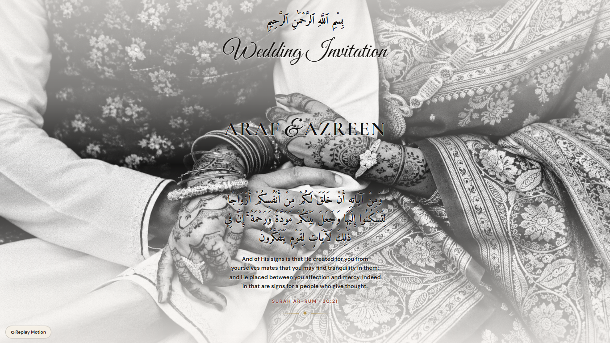
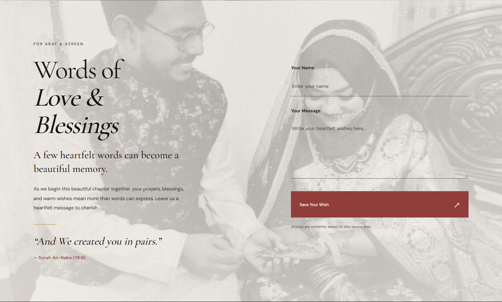
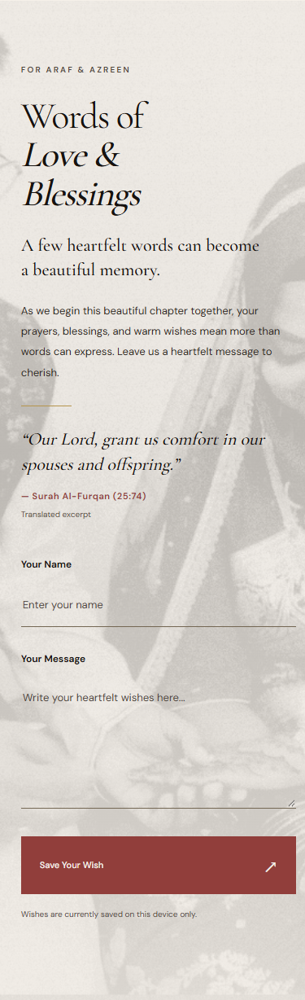
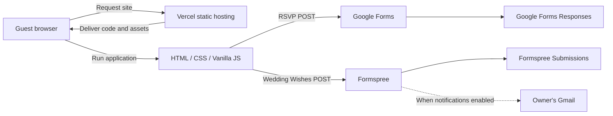
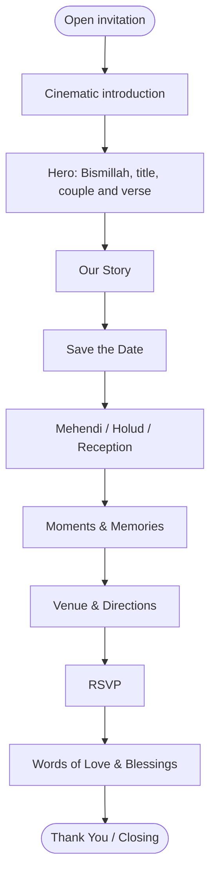
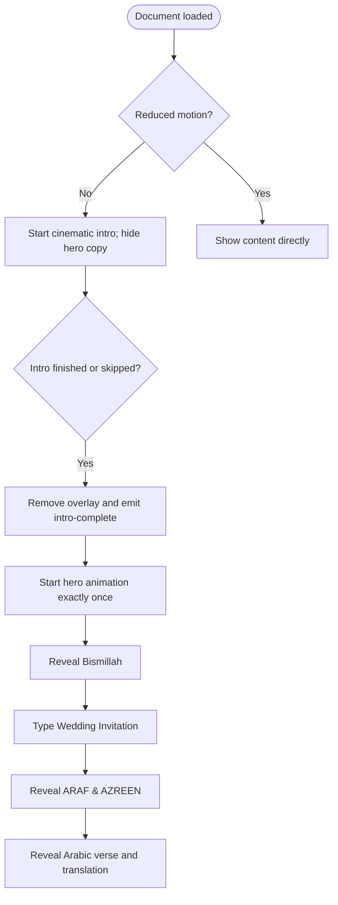
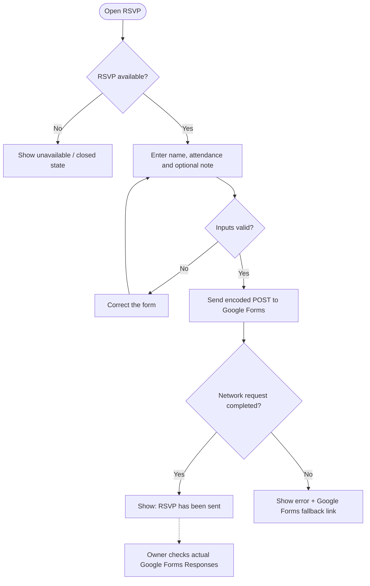
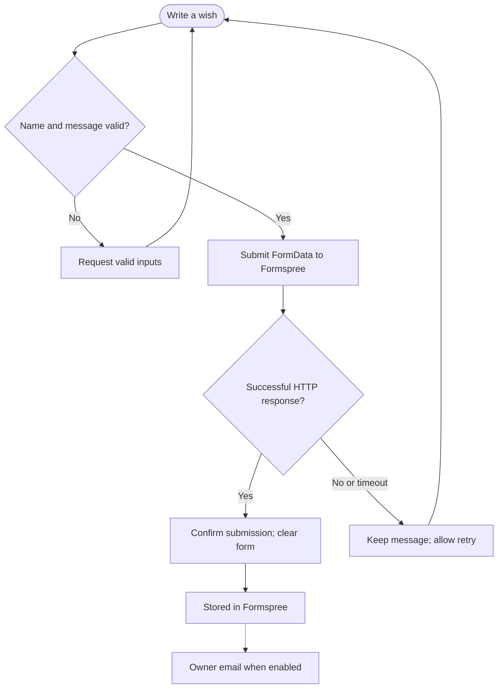
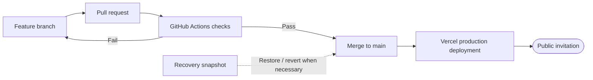

<div align="center">

# ARAF & AZREEN
### A Cinematic Wedding Invitation

**A handcrafted digital wedding gift — where storytelling meets thoughtful web engineering.**

[](https://developer.mozilla.org/en-US/docs/Web/HTML)
[](https://developer.mozilla.org/en-US/docs/Web/CSS)
[](https://developer.mozilla.org/en-US/docs/Web/JavaScript)
[](https://vercel.com/)
[](https://github.com/Shamiul-Bashar/araf-azreen-wedding/actions/workflows/quality.yml)

**[Live Website](https://araf-azreen-wedding.vercel.app/)** · **[Architecture](#system-architecture)** · **[Getting Started](#getting-started)** · **[Configuration](#configuration)**



<sub>16 December 2026 · Kushtia, Bangladesh</sub>

</div>

---

## Overview

**ARAF & AZREEN** is an elegant, photography-led wedding invitation experience. A cinematic opening, graceful typography, Quranic verses, animated storytelling and thoughtful guest interactions come together in one responsive website.

Built as a personal wedding gift, the project goes beyond a digital invitation card: guests can explore the story, wedding timeline, events, photographs, reception venue, RSVP and send private wishes to the couple.

**Engineering approach:** HTML5 + CSS3 + **vanilla JavaScript**, without React, Next.js, a bundler, a custom server or a database. The static site is served by **Vercel**; **Google Forms** handles attendance responses and **Formspree** handles Wedding Wishes.

> **Design principle:** Refined typography, authentic photography, restrained motion and an intuitive guest journey — without sacrificing accessibility or reliability.

## Table of Contents

- [Experience & Features](#experience--features)
- [Gallery & Visual Preview](#gallery--visual-preview)
- [Technology Stack](#technology-stack)
- [System Architecture](#system-architecture)
- [Guest Journey & Cinematic Lifecycle](#guest-journey--cinematic-lifecycle)
- [RSVP & Wedding Wishes](#rsvp--wedding-wishes)
- [Wedding Schedule](#wedding-schedule)
- [Repository Structure](#repository-structure)
- [Getting Started](#getting-started)
- [Configuration](#configuration)
- [Testing & Quality Assurance](#testing--quality-assurance)
- [Deployment & Release Process](#deployment--release-process)
- [Recovery, Security & Limitations](#recovery-security--limitations)
- [Credits](#credits)

## Experience & Features

| Experience | Details | Purpose |
| :-- | :-- | :-- |
| **Cinematic introduction** | Typed couple names, gold particles, soft transitions, Skip Intro | Memorable arrival |
| **Wedding invitation hero** | Arabic Bismillah → typed title → couple names → verse and translation | A meaningful opening |
| **Our Story** | Editorial storytelling, artwork and scripture | Introduce the couple |
| **Save the Date** | Bangladesh-time countdown and event-aware status | Build anticipation |
| **Celebrations** | Mehendi, Holud and Reception from a shared configuration | Organized event details |
| **Moments & Memories** | Responsive photo collage, dialog viewer, keyboard/swipe controls | Explore memories |
| **Venue & Directions** | Reception information and external maps link | Help guests navigate |
| **RSVP** | Name, Yes/No attendance, optional note via Google Forms | Collect replies |
| **Words of Love & Blessings** | Name and message via Formspree; owner notification setup | Send private wishes |
| **Closing chapter** | Full-color photograph, final message and credits | Graceful conclusion |

**Experience refinements:** semantic page structure, skip navigation, focus indicators, animated progress, responsive photo treatments, reduced-motion handling, image fallbacks, Open Graph sharing metadata, and controlled intro-to-hero handoff.

## Gallery & Visual Preview

<div align="center">

| Desktop | Mobile |
| :--: | :--: |
|  |  |
|  |  |

<sub>Representative screenshots from the repository's QA captures. The deployed website is the source of truth for the latest behavior.</sub>

</div>

## Technology Stack

| Layer | Technology | Responsibility |
| :-- | :-- | :-- |
| **Markup** | HTML5 | Semantic sections, forms, navigation, dialog |
| **Presentation** | CSS3 | Typography, layouts, photography, keyframe animations |
| **Application logic** | Vanilla JavaScript | Timing, countdown, events, motion, gallery and submissions |
| **Typography** | Amiri, Cormorant Garamond, Great Vibes, DM Sans | Arabic, editorial display and interface copy |
| **RSVP integration** | Google Forms | Receives guest attendance responses |
| **Wishes integration** | Formspree | Receives guest messages and supports email notifications |
| **Source management** | Git + GitHub | Version history, feature branches, review and backups |
| **Hosting** | Vercel | Production and Git-connected preview deployments |
| **Quality control** | Node.js, GitHub Actions, Playwright Core + Chrome | Simulated integrations and browser regressions |

**No frontend framework or self-hosted backend.** Node.js and Playwright are used for development/testing, not for the deployed application's runtime.

## System Architecture

### Component architecture



> **Boundary:** The website does not have a custom database. Guest responses belong to the configured third-party submission providers. No private access tokens or Gmail credentials are required in frontend code.

### Module responsibilities

| Module | Responsibility |
| :-- | :-- |
| `index.html` | Semantic structure, original hero, inline typewriter logic and form markup |
| `css/styles.css` | Premium layout, responsiveness, photographic scenes and readable inputs |
| `css/intro.css` + `js/intro.js` | Intro overlay, gold particles, watchdog, skip and handoff |
| `css/animations.css` + `js/motion.js` | Scroll reveals, text animation, motion preferences and progress |
| `js/wedding-config.js` | Couple, dates, events, venue, images and RSVP settings |
| `js/main.js` | Event rendering, Bangladesh-time countdown, venue and optional calendars |
| `js/gallery.js` | Lightbox, arrow navigation, swipe, dialog and focus restoration |
| `js/rsvp.js` | Google Forms RSVP and Formspree Wishes request handling |
| `js/music.js` | Optional audio implementation, currently inactive in the live UI |

## Guest Journey & Cinematic Lifecycle

### Visitor journey



### Intro-to-hero state flow



**Why this handoff matters:** The Hero does **not** start with `playing` on the initial HTML. Text remains hidden while `intro-active` is set, including the overlay's fade-out. The `wedding:intro-complete` event starts the intended sequence once, preventing a brief flash of completed Hero content followed by a restart.

The normal intro ends after roughly **3.45 seconds**. An independent **4.2-second fallback watchdog** releases the invitation if the intro script fails. Skip Intro, reduced motion, and no-JavaScript reading are supported.

## RSVP & Wedding Wishes

### RSVP workflow — Google Forms



**Submitted fields:** required guest name, required Yes/No attendance, optional note. Guest count is not collected. Availability depends on `rsvp.isOpen` / `rsvp.closeAfterWedding` in the config.

**Delivery caveat:** A `fetch` request with `mode: 'no-cors'` yields **no readable Google Forms acceptance receipt**. The interface correctly says **sent**, not definitively recorded. The owner previously confirmed a real **Yes** RSVP in Google Forms; the **No** choice should also receive an end-to-end test.

### Wedding Wishes workflow — Formspree



The form uses `method="POST"` and its configured Formspree `action`, providing a native submission fallback if JavaScript is disabled. With JavaScript, `response.ok` is required for success; failures preserve the guest's writing and re-enable the button.

A real submission has previously been confirmed in the owner's Gmail. **Provider acceptance does not imply immediate email delivery**; notification settings and Inbox/Spam checks remain important.

## Wedding Schedule

Configured event times use **Asia/Dhaka (UTC+06:00)**.

| Celebration | Date | Time | Location |
| :-- | :-- | :-- | :-- |
| **Mehendi** | 15 December 2026 | 8:00 PM | Family Residence, Kalishankorpur, Kushtia |
| **Holud** | 16 December 2026 | 1:00 AM | Family Residence, Kalishankorpur, Kushtia |
| **Wedding Day** | 16 December 2026 | Exact ceremony time not provided | — |
| **Reception** | 18 December 2026 | After Jumu'ah Prayer | Kushtia Rifle Club, Kushtia |

The countdown uses the visitor's actual clock and the wedding timezone. When an exact wedding time has not been provided, the countdown refers to the **date**, not an invented ceremony time. Optional calendar downloads require valid start **and** end times.

## Repository Structure

```text
araf-azreen-wedding/
├── index.html
├── css/
│   ├── styles.css
│   ├── animations.css
│   └── intro.css
├── js/
│   ├── wedding-config.js
│   ├── intro.js
│   ├── main.js
│   ├── motion.js
│   ├── gallery.js
│   ├── rsvp.js
│   └── music.js
├── assets/                       # Wedding photographs and scene art
├── qa/                           # Representative QA images and results
├── scripts/
│   ├── check.cjs
│   ├── polish-check.cjs
│   ├── hero-handoff-browser-check.cjs
│   ├── intro-check.cjs
│   ├── browser-check.cjs
│   ├── motion-check.cjs
│   ├── rsvp-check.cjs
│   ├── wishes-check.cjs
│   ├── date-check.cjs
│   ├── events-check.cjs
│   ├── venue-check.cjs
│   └── update-assets.py
├── .github/workflows/quality.yml
├── FINAL-VERIFICATION.md
├── REDESIGN-NOTES.md
└── README.md
```

## Getting Started

### Prerequisites

- A modern browser.
- Git, if cloning the repository.
- VS Code **Live Server** or Python 3 for a local HTTP server.
- Node.js (optional, for QA commands).

### Clone and run

```bash
git clone https://github.com/Shamiul-Bashar/araf-azreen-wedding.git
cd araf-azreen-wedding

# Open with VS Code / Live Server, or:
python -m http.server 5500
```

Visit **http://localhost:5500/**. GitHub authentication is needed when cloning a private repository.

No `npm install` or application build is required to run the website.

### Execute offline checks

```bash
node scripts/check.cjs
node scripts/polish-check.cjs
```

These run with simulated submission requests; **no real Google Form entry or Formspree email is sent**.

## Configuration

The editable source of truth is **[`js/wedding-config.js`](js/wedding-config.js)**.

| Setting | Use | Guidance |
| :-- | :-- | :-- |
| `couple` | Couple names | Keep display names consistent with the manually authored Hero text |
| `story` | Introductory story | Modify only approved wording |
| `wedding.date` | Primary date | ISO `YYYY-MM-DD` |
| `wedding.time` | Optional exact time | `null` until confirmed, otherwise 24-hour `HH:mm` |
| `wedding.timezone` | Calendar/countdown math | `Asia/Dhaka` |
| `events[]` | Individual celebrations | Each has its own date, time, venue, location and description |
| `venue` | Reception/map content | Use a valid HTTPS map URL |
| `photos` | Hero, story, gallery, closing | Existing paths under `assets/` |
| `availableAssets` | Asset inventory | Refresh after image updates |
| `rsvp.isOpen` | RSVP override | `null` automatic; `true` open; `false` closed |
| `rsvp.googleForms` | RSVP provider fields | Maintain exact field IDs and option values |
| `developer.portfolioUrl` | Attribution | Current portfolio URL |

**To change photographs:** Add a real image to `assets/`, update the relevant path, then run:

```bash
python scripts/update-assets.py
```

The gallery ignores missing optional images. Photos should be reviewed on mobile and desktop before deployment. The original image treatment is monochrome in most chapters; the closing portrait retains color.

**To change colors or fonts:** Most scene styles are in `css/styles.css`; isolated Intro styles are in `css/intro.css`; original Hero styling and typing logic also live inside `index.html`. Avoid global style changes that alter the approved photographic composition.

**To change submissions:** RSVP's public Google Forms identifiers are in `js/wedding-config.js`. Formspree's action URL is in the Wedding Wishes form in `index.html`. Never add private credentials to browser code; test with real submissions after changing the provider configuration.

## Testing & Quality Assurance

| Verification | File/tool | What it covers |
| :-- | :-- | :-- |
| JS syntax | `node --check` | Static script parsing |
| Simulated logic and integrations | `scripts/check.cjs` | Date boundaries, RSVP payload, Formspree payload, gallery |
| Static design/integration safeguards | `scripts/polish-check.cjs` | Semantic headings, Hero initial state, URLs, assets, unique IDs |
| **Real Chrome Hero handoff** | `scripts/hero-handoff-browser-check.cjs` | No premature text flash; intro exit, mobile/desktop, reduced motion, skip, no-JS |
| GitHub CI | `.github/workflows/quality.yml` | Runs source checks and real Chrome handoff on PRs and branch pushes |
| Optional visual/browser tests | `scripts/*-check.cjs` | Gallery, motion, events, date, RSVP and Wishes behavior |

The automated browser job installs Playwright Core in the runner's temporary directory and uses Chrome. The production website itself has **no Playwright dependency**.

**Scope and limits:** Form requests in automated checks are mocked, not actually delivered. Browser testing does not replace physical Android/iOS checks, Safari/Firefox testing, Lighthouse measurements or an external provider delivery test. Historic images in `qa/` are test artifacts, not a guarantee that every viewport has been physically tested.

[View the automated workflow](https://github.com/Shamiul-Bashar/araf-azreen-wedding/actions/workflows/quality.yml)

## Deployment & Release Process

The source repository is connected to **Vercel**. Feature branches can create previews, while merges to `main` produce production deployments.



| Vercel setting | Value |
| :-- | :-- |
| Production URL | **[araf-azreen-wedding.vercel.app](https://araf-azreen-wedding.vercel.app/)** |
| Framework preset | **Other** — static HTML/CSS/JS |
| Root directory | Repository root |
| Build command | None required |
| Entry point | `index.html` |
| Production Git branch | `main` |
| Custom API/database | Not used |

**Workflow:** update a feature branch → open a PR → wait for CI → review → merge → confirm the Vercel production deployment is `READY`. Keep backup refs before important aesthetic or interaction changes.

## Recovery, Security & Limitations

### Protected recovery points

| Version | Commit | Recovery reference |
| :-- | :-- | :-- |
| **Pre-polish website** | `4536883` | [Backup branch](https://github.com/Shamiul-Bashar/araf-azreen-wedding/tree/backup/production-2026-10-19-pre-polish) |
| **Approved polished design before Hero handoff fix** | `1a3e970` | [Backup branch](https://github.com/Shamiul-Bashar/araf-azreen-wedding/tree/backup/approved-production-before-hero-handoff-fix) |
| **Current live version** | `main` | [Production website](https://araf-azreen-wedding.vercel.app/) |

For an urgent rollback, inspect the previous READY deployment in Vercel. For a source-level restoration, create a recovery branch from the appropriate commit and merge a reviewed revert PR. **Do not force-push `main`** or overwrite backup branches.

### Operational considerations

- Google Forms and Formspree process the names/messages sent to those providers. Review their settings before sharing the site widely.
- The Google Forms `no-cors` request has **no readable delivery receipt**; verify actual submissions in the Google Forms Responses panel.
- Formspree's HTTP acceptance is not an immediate-Gmail guarantee. Check notification settings and provider submissions.
- Do not commit private API keys, Gmail passwords, guest records or other secrets. The site has no local wish-message storage.
- Optional gallery images 3 and 4 are skipped when unavailable.
- The retained music module is optional and **not an active interface feature** in the currently approved design.
- Feature availability and submission delivery may depend on connectivity, browser settings and third-party service quotas.

> **Personal-use project:** The repository contains family event details and personal wedding photography. Do not redistribute imagery, messages or invitation details without permission. No open-source license has been declared.

## Credits

**Designed and developed by [MD SHAMIUL BASHAR SIAM](https://shamiul-dev.vercel.app/)**  
Computer Science & Engineering Undergraduate · Khulna University of Engineering & Technology (KUET)

Created as a personal wedding gift for **Araf & Azreen**.

<div align="center">

*Crafted with love, faith and attention to detail.*

**[Visit the Wedding Website](https://araf-azreen-wedding.vercel.app/)**

</div>

